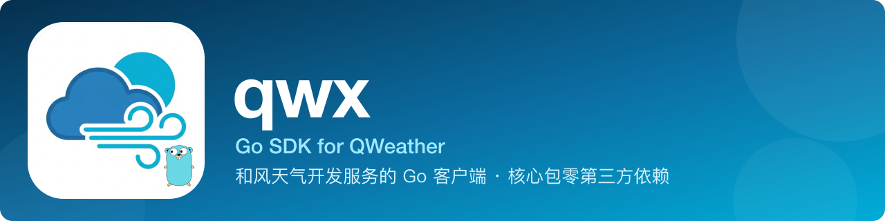

<p align="center">
  
</p>

<p align="center">
  <a href="https://github.com/KanoCifer/qwx/actions/workflows/ci.yml" target="_blank" rel="noopener"></a>
  <a href="https://go.dev" target="_blank" rel="noopener"></a>
  <a href="https://github.com/KanoCifer/qwx/releases" target="_blank" rel="noopener"></a>
  <a href="https://github.com/KanoCifer/qwx/blob/main/LICENSE" target="_blank" rel="noopener"></a>
  <a href="https://pkg.go.dev/github.com/KanoCifer/qwx" target="_blank" rel="noopener"></a>
  <a href="https://goreportcard.com/report/github.com/KanoCifer/qwx" target="_blank" rel="noopener"></a>
  <a href="https://github.com/KanoCifer/qwx#支持的接口" target="_blank" rel="noopener"></a>
  <a href="https://github.com/KanoCifer/qwx/blob/main/go.mod" target="_blank" rel="noopener"></a>
  <a href="https://github.com/KanoCifer/qwx/stargazers" target="_blank" rel="noopener"></a>
</p>

<p align="center">
  <a href="README.md"><b>简体中文</b></a> · <a href="README_EN.md">English</a>
</p>

qwx 是社区维护的 Go SDK，覆盖上游文档中的核心接口族，返回类型化的 Go 结构体，核心包零第三方依赖。

---

<details>
<summary><b>📖 目录</b></summary>

- [✨ 特性](#特性)
- [📦 安装](#安装)
- [🚀 快速开始](#快速开始)
- [📖 使用指南](#使用指南)
  - [🔑 认证](#认证)
  - [⚙️ 客户端选项](#客户端选项)
  - [📍 位置](#位置)
  - [🌐 多语言](#多语言)
  - [🌤️ 天气](#天气)
  - [🌫️ 空气质量](#空气质量)
  - [⚠️ 预警](#预警)
  - [🗺️ GeoAPI 检索](#geoapi-检索)
  - [🌊 潮汐](#潮汐)
  - [🧭 生活指数](#生活指数)
  - [🌧️ 分钟级降水](#分钟级降水)
  - [☀️ 太阳辐射预报](#太阳辐射预报)
  - [🌀 台风](#台风)
  - [🔭 天文](#天文)
  - [⏳ 历史天气](#历史天气)
  - [💼 控制台](#控制台)
  - [🗄️ 缓存](#缓存)
  - [📝 日志](#日志)
  - [🚨 错误处理](#错误处理)
  - [⏱️ 并发与超时](#并发与超时)
  - [🧪 测试](#测试)
- [🔌 支持的接口](#支持的接口)
- [🧩 qwx 封装的 redis 缓存](#qwx-封装的-redis-缓存)
- [📚 文档](#文档)
- [🔗 官方文档](#官方文档)
- [⚖️ 许可](#许可)

</details>

## ✨ 特性

- **核心接口全覆盖**：GeoAPI 城市与 POI 检索、天气预报（新一代 `/weather/v1/*`）、空气质量、预警、太阳辐射预报、海洋潮汐、生活指数、分钟级降水预报、台风、天文、历史天气
- **在役端点全覆盖（截至 2026-10-29）**：上游 28 个端点，在役的都已接入。
- **按资源族分包**：一个包对应一个上游资源族，字段形态与缓存键互不污染
- **两种认证**：JWT（Ed25519 签名，官方推荐）与 API KEY
- **零依赖**：核心包只用标准库，`go.mod` 没有 `require`
- **缓存可插拔**：定义 `Cache` 接口，Redis、内存与自定义实现都可注入
- **日志可插拔**：使用标准库 `log/slog`，不注入时不输出
- **错误可分类**：用 `errors.Is` 判断类别，无需解析错误字符串
- **并发安全**：`Client` 无状态，可直接共享

---

## 📦 安装

```bash
go get github.com/KanoCifer/qwx
```

要求 Go 1.24 及以上。

需要 Redis 缓存时，额外引入独立的缓存模块。它依赖 go-redis v9.23.0，最低 Go 版本是 1.26，核心模块不受影响：

```bash
go get github.com/KanoCifer/qwx/rediscache
```

---

## 🚀 快速开始

三步：创建认证、创建基础客户端、创建接口族的客户端。

```go
package main

import (
	"context"
	"fmt"
	"log"
	"os"

	"github.com/KanoCifer/qwx"
	"github.com/KanoCifer/qwx/v1/weather"
)

func main() {
	// 1. 认证。JWT 用控制台分配的凭据，API KEY 用 qwx.NewAPIKeyAuth。
	auth, err := qwx.NewJWTAuth(qwx.JWTConfig{
		PrivateKeyPEM: os.Getenv("QWEATHER_JWT_PRIVATE_KEY"),
		KeyID:         os.Getenv("QWEATHER_KEY_ID"),
		ProjectID:     os.Getenv("QWEATHER_PROJECT_ID"),
		DeveloperID:   os.Getenv("QWEATHER_DEVELOPER_ID"), // 必填，控制台「设置」页
	})
	if err != nil {
		log.Fatal(err)
	}

	// 2. 基础客户端。apiHost 是控制台「设置」页分配的专属 Host，必填。
	base, err := qwx.NewClient(auth, "abcxyz.qweatherapi.com")
	if err != nil {
		log.Fatal(err)
	}

	// 3. 各接口族用基础客户端构造自己的服务客户端。
	w := weather.New(base)

	ctx := context.Background()
	loc, err := qwx.ParseLocation("116.41,39.92") // 经度在前
	if err != nil {
		log.Fatal(err)
	}

	current, err := w.Current(ctx, loc, weather.Options{
		Lang:      qwx.LangZH,
		LocalTime: true, // 不传会拿到 UTC，时间差 8 小时
	})
	if err != nil {
		log.Fatal(err)
	}

	fmt.Println(current.Condition.Text, current.Temperature.Value, current.Temperature.Unit)
}
```

仓库里的 `examples/basic` 是一个更长的例子，覆盖天气、逐时逐日、城市检索与生活指数，走 API KEY 认证，从环境变量读配置：

```bash
export QWEATHER_API_KEY="你的 API KEY"
export QWEATHER_API_HOST="abcxyz.qweatherapi.com"
go run ./examples/basic
```

API Host 只能从控制台「设置」页取，没有默认值：公共域名 `devapi.qweather.com`（2026-01 停服）、`api.qweather.com`、`geoapi.qweather.com`（2026-06 停服）陆续失效。Host 只写域名不带 scheme 时，SDK 自动补 `https://`。

---

## 📖 使用指南

### 🔑 认证

两种认证不能同时使用，同时带上会让上游拒绝请求。默认选 JWT。

JWT 需要 Ed25519 密钥对，公钥上传到控制台：

```bash
openssl genpkey -algorithm ED25519 -out ed25519-private.pem
openssl pkey -pubout -in ed25519-private.pem > ed25519-public.pem
```

控制台创建凭据后拿到 Key ID、Project ID、Developer ID，三项都必填：

```go
import "github.com/KanoCifer/qwx"

auth, err := qwx.NewJWTAuth(qwx.JWTConfig{
	PrivateKeyPEM: string(privateKeyPEM),
	KeyID:         "YOUR_KEY_ID",
	ProjectID:     "YOUR_PROJECT_ID",
	DeveloperID:   "YOUR_DEVELOPER_ID",
})
```

三项各对应 JWT 的一个位置：`kid` 是凭据 ID，`sub` 是项目 ID，`iss` 是 Developer ID（控制台「设置」页，形如 Q 开头的 10 位字母数字）。`iss` 官方口径是必填的签发者，缺失时上游按它校验凭据归属会失败，所以 SDK 直接在构造时返回 `ErrInvalidConfig`，不等到上游 401 才发现漏配。

JWT 有效期 15 分钟，SDK 在过期前 1 分钟自动重签，调用方不用管。签名有锁，并发安全。

API KEY（不推荐使用）适合存量项目：

```go
import "github.com/KanoCifer/qwx"

auth, err := qwx.NewAPIKeyAuth("YOUR_API_KEY")
```

> 官方已公告：2027-01-01 起限制用 API KEY 认证的每日请求量，且 SDK 5+ 不再支持 API KEY。新项目建议直接用 JWT。

### ⚙️ 客户端选项

所有选项都传给基础客户端构造器：

| 选项 | 作用 |
| --- | --- |
| `qwx.WithCache` | 注入 `Cache` 实现，不注入时每次请求都打到上游 |
| `qwx.WithTTLPolicy` | 按端点决定缓存时长 |
| `qwx.WithLogger` | 注入 `log/slog` 日志器，不注入时默认静默 |
| `qwx.WithHTTPClient` | 替换底层 `http.Client`，SDK 不改它的超时 |
| `qwx.WithAuth` | 覆盖认证方式，等价于构造器传入的 `auth` |
| `qwx.WithClock` | 注入时钟，供测试断言 JWT 的 `iat` 与 `exp` |

```go
base, err := qwx.NewClient(auth, "abcxyz.qweatherapi.com",
	qwx.WithCache(myRedisCache),
	qwx.WithTTLPolicy(qwx.TTLMap{weather.EndpointCurrent: 30 * time.Second}),
	qwx.WithLogger(slog.Default()),
)
```

### 📍 位置

`qwx.Location` 收敛了上游的三种位置形态：

```go
import (
	"fmt"

	"github.com/KanoCifer/qwx"
)

// 坐标对，字符串里经度在前
coord, err := qwx.ParseLocation("116.41,39.92")
if err != nil {
	return err
}
fmt.Println(coord.Lat, coord.Lon)

// 直接构造，字段是纬度在前
loc := qwx.Location{Lat: 39.92, Lon: 116.41}

// LocationID
station := qwx.Location{ID: "101010100"}

// 地名，只有 GeoAPI 城市/POI 检索认
city := qwx.Location{Name: "杭州"}

fmt.Println(loc, station, city)
```

各端点认哪种形态不一样：

| 形态 | 谁认 |
| --- | --- |
| 坐标对 | 全部端点 |
| LocationID | `geo.LookupCity`、`geo.LookupPOI`、`astronomy.Sun`、`astronomy.Moon`；行政区划是 9~10 位数字，POI 是数字加字母后缀，潮汐站是 `P` 加数字 |
| 地名 | 只有 `geo.LookupCity` 与 `geo.LookupPOI` |

新一代只认坐标。手里只有 LocationID 时，先用 `geo.LookupCity` 换成坐标。

坐标顺序分两代：新一代走路径参数，纬度在前（`Location.Path()`）；v7 与 GeoAPI 走查询参数，经度在前（`Location.Query()`）。写反了上游直接回 400。

### 🌐 多语言

上游用 `lang` 查询参数切换返回的语言。语言用 `qwx.Lang` 表示，SDK 内置官方「多语言」页列出的 31 种语言：

| 语言 | 变量 | API 代码 |
| --- | --- | --- |
| 简体中文 | `qwx.LangZH` | `zh` |
| 繁体中文 | `qwx.LangZHHant` | `zh-hant` |
| 英文 | `qwx.LangEN` | `en` |
| 德语 | `qwx.LangDE` | `de` |
| 西班牙语 | `qwx.LangES` | `es` |
| 法语 | `qwx.LangFR` | `fr` |
| 意大利语 | `qwx.LangIT` | `it` |
| 日语 | `qwx.LangJA` | `ja` |
| 韩语 | `qwx.LangKO` | `ko` |
| 俄语 | `qwx.LangRU` | `ru` |
| 印地语 | `qwx.LangHI` | `hi` |
| 泰语 | `qwx.LangTH` | `th` |
| 阿拉伯语 | `qwx.LangAR` | `ar` |
| 葡萄牙语 | `qwx.LangPT` | `pt` |
| 孟加拉语 | `qwx.LangBN` | `bn` |
| 马来语 | `qwx.LangMS` | `ms` |
| 荷兰语 | `qwx.LangNL` | `nl` |
| 希腊语 | `qwx.LangEL` | `el` |
| 拉丁语 | `qwx.LangLA` | `la` |
| 瑞典语 | `qwx.LangSV` | `sv` |
| 印尼语 | `qwx.LangID` | `id` |
| 波兰语 | `qwx.LangPL` | `pl` |
| 土耳其语 | `qwx.LangTR` | `tr` |
| 捷克语 | `qwx.LangCS` | `cs` |
| 爱沙尼亚语 | `qwx.LangET` | `et` |
| 越南语 | `qwx.LangVI` | `vi` |
| 菲律宾语 | `qwx.LangFIL` | `fil` |
| 芬兰语 | `qwx.LangFI` | `fi` |
| 希伯来语 | `qwx.LangHE` | `he` |
| 冰岛语 | `qwx.LangIS` | `is` |
| 挪威语 | `qwx.LangNB` | `nb` |

语言留空（零值 `qwx.Lang{}`）用上游默认：所在国家或地区的官方语言，没有官方语言时回退到英语。

```go
cur, err := w.Current(ctx, loc, weather.Options{Lang: qwx.LangZH, LocalTime: true})
```

按代码反查语言，官方给的等价代码也认：

```go
lang, ok := qwx.LookupLang("zh-hans") // 简体中文的另一个等价代码
```

语言代码形态不对时返回 `ErrInvalidParameter`，不打上游。太阳辐射预报、潮汐、台风、日出日落与太阳高度角这几个端点没有语言参数，上游不认。

### 🌤️ 天气

```go
import (
	"context"

	"github.com/KanoCifer/qwx"
	"github.com/KanoCifer/qwx/v1/weather"
)

w := weather.New(base)
ctx := context.Background()
loc := qwx.Location{Lat: 39.92, Lon: 116.41}

current, err := w.Current(ctx, loc, weather.Options{Lang: qwx.LangZH, LocalTime: true})
if err != nil {
	return err
}
fmt.Println(current.Condition.Text, current.Temperature.Value, current.Temperature.Unit)
fmt.Println(current.Humidity*100, "%") // 湿度是 0~1 的比例

hourly, err := w.Hourly(ctx, loc, 24, weather.Options{Lang: qwx.LangZH, LocalTime: true})
if err != nil {
	return err
}
for _, h := range hourly.Hours {
	var prob float64
	if h.Precipitation.Probability != nil {
		prob = *h.Precipitation.Probability
	}
	fmt.Println(h.ForecastTime, h.Condition.Text, prob)
}

daily, err := w.Daily(ctx, loc, 3, weather.Options{Lang: qwx.LangZH, LocalTime: true})
if err != nil {
	return err
}
for _, d := range daily.Days {
	fmt.Println(d.ForecastStartTime, d.TemperatureMax.Value, d.TemperatureMin.Value)
}
```

`Hourly` 的 hours 取 1~240，`Daily` 的 days 取 1~10，越界返回 `ErrInvalidParameter`，不打上游。列表长度不假设，上游可能给得更少。

### 🌫️ 空气质量

```go
import (
	"context"

	"github.com/KanoCifer/qwx"
	"github.com/KanoCifer/qwx/v1/airquality"
)

aq := airquality.New(base)
ctx := context.Background()
loc := qwx.Location{Lat: 39.92, Lon: 116.41}

cur, err := aq.Current(ctx, loc, airquality.Options{Lang: qwx.LangZH})
if err != nil {
	return err
}
for _, idx := range cur.Indexes {
	fmt.Println(idx.Code, idx.AQI, idx.Category)
}

// 附近监测站，再按站点查实测数据
for _, s := range cur.Stations {
	station, err := aq.Station(ctx, s.ID, airquality.Options{Lang: qwx.LangZH})
	if err != nil {
		return err
	}
	fmt.Println(s.Name, station.Pollutants)
}

// 逐日与逐小时预报
daily, err := aq.Daily(ctx, loc, airquality.Options{Lang: qwx.LangZH})
if err != nil {
	return err
}
hourly, err := aq.Hourly(ctx, loc, airquality.Options{Lang: qwx.LangZH})
if err != nil {
	return err
}
fmt.Println(len(daily.Days), len(hourly.Hours))
```

不同标准的 AQI 量纲不同（QAQI 是 0~1，US EPA 是 0~500），不要跨标准比较。

### ⚠️ 预警

```go
import (
	"context"

	"github.com/KanoCifer/qwx"
	"github.com/KanoCifer/qwx/v1/alert"
)

al := alert.New(base)
ctx := context.Background()
loc := qwx.Location{Lat: 39.92, Lon: 116.41}

result, err := al.Current(ctx, loc, alert.Options{Lang: qwx.LangZH, LocalTime: true})
if err != nil {
	return err
}
for _, a := range result.Alerts {
	fmt.Println(a.SenderName, a.Headline, a.Severity, a.EffectiveTime)
}
```

预警只认坐标。没有预警时上游返回空列表，`Metadata.ZeroResult` 指向 `true`。

### 🗺️ GeoAPI 检索

```go
import (
	"context"

	"github.com/KanoCifer/qwx"
	"github.com/KanoCifer/qwx/geo"
)

g := geo.New(base)
ctx := context.Background()

// 按地名检索城市
cities, err := g.LookupCity(ctx, qwx.Location{Name: "杭州"}, geo.Options{Lang: qwx.LangZH, Number: 10})
if err != nil {
	return err
}
for _, c := range cities.Locations {
	lat, lon, err := c.Coordinates()
	if err != nil {
		return err
	}
	fmt.Println(c.ID, c.DisplayName(), lat, lon)
}

// 附近潮汐站
pois, err := g.LookupPOI(ctx, qwx.Location{Lat: 30.0, Lon: 122.0}, geo.POITSTA, geo.Options{Lang: qwx.LangZH})
if err != nil {
	return err
}
for _, p := range pois.POIs {
	fmt.Println(p.ID, p.Name)
}

// 热门城市
top, err := g.TopCities(ctx, geo.Options{Lang: qwx.LangZH})
if err != nil {
	return err
}
for _, c := range top.Cities {
	fmt.Println(c.DisplayName())
}
```

`POIRange` 检索指定坐标附近的 POI，只认坐标，`Radius` 是公里数：

```go
ranges, err := g.POIRange(ctx, qwx.Location{Lat: 30.0, Lon: 122.0}, geo.POIScenic,
	geo.POIRangeOptions{Lang: qwx.LangZH, Number: 10, Radius: 20})
if err != nil {
	return err
}
for _, p := range ranges.POIs {
	fmt.Println(p.ID, p.Name)
}
```

GeoAPI 的四个检索端点共用一组可选参数：

| 参数 | 作用 | 谁认 |
| --- | --- | --- |
| `Lang` | 语言，留空用上游默认 | 全部 |
| `Number` | 返回条数上限，0 用上游默认（10） | 全部 |
| `Adm` | 上级行政区划的 LocationID，用于排除重名城市 | 城市检索 |
| `Range` | 搜索范围，ISO 3166 国家代码，如 `cn`、`world` | 城市检索、热门城市 |
| `City` | 限定 POI 所在城市，城市名或 LocationID | POI 检索 |

GeoAPI 的每个结果都带一个 `Refer`，是数据来源与许可声明。展示 GeoAPI 数据时要一并展示：

```go
for _, s := range cities.Refer.Sources {
	fmt.Println(s)
}
```

旧一代（v7）五个端点族（潮汐、生活指数、分钟级降水、台风、天文）的结果同样带 `Refer`，取法一样。

### 🌊 潮汐

潮汐站 ID 用 `geo.LookupPOI` 配 `geo.POITSTA` 检索，日期用站点当地当天：

```go
import (
	"context"
	"time"

	"github.com/KanoCifer/qwx/v7/ocean"
)

o := ocean.New(base)
ctx := context.Background()

// date 是潮汐站当地日期，格式 YYYYMMDD
date := time.Now().Format("20060102")
result, err := o.Tide(ctx, "P2419", date)
if err != nil {
	return err
}
for _, t := range result.TideTable {
	fmt.Println(t.FXTime, t.Height, t.Type) // Type: H 高潮 / L 低潮
}
```

潮位高度保持字符串，保留上游给的小数位数。

### 🧭 生活指数

```go
import (
	"context"

	"github.com/KanoCifer/qwx"
	"github.com/KanoCifer/qwx/v7/indices"
)

idx := indices.New(base)
ctx := context.Background()
loc := qwx.Location{Lat: 39.92, Lon: 116.41}

// typ 取 0~16，0 表示全部；days 只支持 1 与 3
result, err := idx.Indices(ctx, loc, indices.TypeFishing, 1, "zh")
if err != nil {
	return err
}
for _, d := range result.Daily {
	fmt.Println(d.Date, d.Name, d.Category, d.Text)
}

// 一次拿多种指数：上游的 type 支持逗号分隔
multi, err := idx.IndicesMulti(ctx, loc, []int{4, 5}, 1, "zh")
if err != nil {
	return err
}
fmt.Println(len(multi.Daily))
```

### 🌧️ 分钟级降水

```go
import (
	"context"

	"github.com/KanoCifer/qwx"
	"github.com/KanoCifer/qwx/v7/minutely"
)

mi := minutely.New(base)
ctx := context.Background()
loc := qwx.Location{Lat: 39.92, Lon: 116.41}

result, err := mi.Minutely(ctx, loc, "zh")
if err != nil {
	return err
}
fmt.Println(result.Summary)
for _, m := range result.Minutely {
	fmt.Println(m.FXTime, m.Precip, m.Type)
}
```

只覆盖中国区域，境外坐标上游没有数据。`Precip` 是字符串：空串表示「无此数据」，`"0.00"` 表示「真的没下雨」。

### ☀️ 太阳辐射预报

新一代端点，只认坐标，路径参数纬度在前：

```go
import (
	"context"

	"github.com/KanoCifer/qwx"
	"github.com/KanoCifer/qwx/v1/solarradiation"
)

sr := solarradiation.New(base)
ctx := context.Background()
loc := qwx.Location{Lat: 39.92, Lon: 116.41}

// hours 取 1~72；interval 只能是 15、30、60
result, err := sr.Forecast(ctx, loc, 24, solarradiation.Options{
	Interval: 60,
	Extra:    "weather",
})
if err != nil {
	return err
}
for _, f := range result.Forecasts {
	fmt.Println(f.ForecastTime, f.GHI.Value, f.GHI.Unit)
}
```

要光伏阵列平面辐照度就把 `Extra` 设为 `"poa"`，同时给 `Tilt` 与 `Azimuth`。这两个字段是指针，用来区分「不传」与「传 0」：

```go
tilt, azimuth := 30, 180
result, err := sr.Forecast(ctx, loc, 24, solarradiation.Options{
	Interval: 60,
	Extra:    "poa",
	Tilt:     &tilt,
	Azimuth:  &azimuth,
})
if err != nil {
	return err
}
for _, f := range result.Forecasts {
	fmt.Println(f.ForecastTime, f.POA.Global.Value, f.POA.Global.Unit)
}
```

这一族没有 `lang` 参数，上游不返回文字描述，多传会被拒。

### 🌀 台风

三个端点都不收位置参数，按流域与台风 ID 检索：

```go
import (
	"context"

	"github.com/KanoCifer/qwx/v7/storm"
)

st := storm.New(base)
ctx := context.Background()

// basin 目前上游只支持 NP
list, err := st.List(ctx, storm.BasinNP, 2026)
if err != nil {
	return err
}
for _, s := range list.Storms {
	fmt.Println(s.ID, s.Name, s.IsActive) // IsActive: "1" 活跃 / "0" 停编
}

forecast, err := st.Forecast(ctx, "NP2026")
if err != nil {
	return err
}
fmt.Println(len(forecast.Forecast))

track, err := st.Track(ctx, "NP2026")
if err != nil {
	return err
}
fmt.Println(len(track.Track))
```

### 🔭 天文

```go
import (
	"context"
	"time"

	"github.com/KanoCifer/qwx"
	"github.com/KanoCifer/qwx/v7/astronomy"
)

as := astronomy.New(base)
ctx := context.Background()
loc := qwx.Location{Lat: 39.92, Lon: 116.41}
date := time.Now().Format("20060102")

sun, err := as.Sun(ctx, loc, date)
if err != nil {
	return err
}
if sun.Sunrise != nil {
	fmt.Println(*sun.Sunrise, *sun.Sunset)
}

moon, err := as.Moon(ctx, loc, date, astronomy.Options{Lang: qwx.LangZH})
if err != nil {
	return err
}
fmt.Println(len(moon.MoonPhase))

// 太阳高度角只认坐标，还要给时刻、时区与海拔
angle, err := as.SolarElevationAngle(ctx, loc, date, "1200", "0800", 43)
if err != nil {
	return err
}
fmt.Println(angle.SolarElevationAngle, angle.SolarAzimuthAngle)
```

### ⏳ 历史天气

历史天气（上游叫「天气时光机」）只认 LocationID，日期是最近 10 天、不含今天。

```go
import (
	"context"
	"time"

	"github.com/KanoCifer/qwx"
	"github.com/KanoCifer/qwx/v7/historical"
)

hs := historical.New(base)
ctx := context.Background()
// 上游只给最近 10 天、不含今天的数据
date := time.Now().AddDate(0, 0, -1).Format("20060102")

got, err := hs.Weather(ctx, qwx.Location{ID: "101010100"}, date, historical.Options{Lang: qwx.LangZH})
if err != nil {
	return err
}
if got.Daily != nil {
	fmt.Println(got.Daily.Date, got.Daily.TempMax, got.Daily.TempMin)
}
fmt.Println(len(got.Hourly))
```

### 💼 控制台

控制台 API 查的是帐号自己的财务与请求量，不是天气数据。凭据默认没有权限：
帐号所有者要在控制台的「项目管理 - 凭据 - 控制台权限」里开通，否则上游回 403。

```go
import (
	"context"

	"github.com/KanoCifer/qwx"
	"github.com/KanoCifer/qwx/console"
)

c := console.New(base)
ctx := context.Background()

fin, err := c.Finance(ctx)
if err != nil {
	return err
}
fmt.Println(fin.Currency, fin.Balance, fin.AsOf)

// 待支付的账单
for _, b := range fin.PendingBills {
	fmt.Println(b.Number, b.Type, b.Status, b.AmountDue, b.DueDate)
}

// 最近 24 小时的请求量统计
stats, err := c.Stats(ctx, console.StatsOptions{})
if err != nil {
	return err
}
for _, s := range stats.Success {
	fmt.Println(s.API, s.Hours)
}
```

`Project` 与 `Credential` 互斥，都留空时统计帐号下所有项目与凭据。资源包的
总请求量上游给的是字符串，SDK 用 `json.Number` 收：

```go
for _, p := range fin.AvailableResourcePlans {
	n, _ := p.Requests.Int64()
	fmt.Println(p.BillNumber, n)
}
```

返回的数据截止至上一个小时或更早，与控制台网页上显示的可能有 1 小时或更长的
延迟，以响应里的 `AsOf` 为准。

### 🗄️ 缓存

SDK 不内置缓存实现，注入已有实现：

```go
import "github.com/KanoCifer/qwx"

base, err := qwx.NewClient(auth, "abcxyz.qweatherapi.com", qwx.WithCache(myRedisCache))
```

内置的内存缓存 `qwx.NewMemoryCache()` **不建议用于生产环境**：它没有后台清理，过期条目只在被命中时顺手删除，长跑进程的内存占用只增不减。只拿它当测试替身或单实例临时缓存：

```go
import "github.com/KanoCifer/qwx"

base, err := qwx.NewClient(auth, "abcxyz.qweatherapi.com", qwx.WithCache(qwx.NewMemoryCache()))
```

用 Redis 就引入 `rediscache` 模块，它实现了 `qwx.Cache`：

```go
import (
	"github.com/KanoCifer/qwx"
	"github.com/KanoCifer/qwx/rediscache"
)

cache, err := rediscache.New(rediscache.Options{
	Addr: "127.0.0.1:6379",
	// Password: "...",  需要认证时填
	// KeyPrefix: "myapp:",  多个应用共用一个 Redis 实例时隔离键
})
if err != nil {
	return err
}
defer cache.Close()

base, err := qwx.NewClient(auth, "abcxyz.qweatherapi.com", qwx.WithCache(cache))
```

`rediscache` 支持 TLS（`TLSConfig`）、ACL 用户名（`Username`）、指定库（`DB`）与连接超时。构造时不会连 Redis，用 `cache.Ping(ctx)` 做启动自检。

缓存键由 SDK 生成（两代接口刻意不共键，避免旧缓存喂给新解析器），TTL 按端点的数据更新节奏设定。缓存键不含 API Host，一个 `Cache` 实例只服务一个 Host。

要按端点调 TTL，传一份策略：

```go
import (
	"time"

	"github.com/KanoCifer/qwx"
	"github.com/KanoCifer/qwx/v1/airquality"
	"github.com/KanoCifer/qwx/v1/weather"
)

base, err := qwx.NewClient(auth, "abcxyz.qweatherapi.com",
	qwx.WithCache(myRedisCache),
	qwx.WithTTLPolicy(qwx.TTLMap{
		weather.EndpointCurrent:    30 * time.Second,
		airquality.EndpointCurrent: 0, // 该端点不缓存
	}),
)
```

端点常量在各端点包里（`weather.EndpointCurrent`、`geo.EndpointCity` 等）。单端点包只导出一个端点时，名字就是 `Endpoint`（`alert.Endpoint`、`ocean.Endpoint`）。默认时长：

| 端点 | 端点常量 | 默认 TTL |
| --- | --- | --- |
| 天气实况 | `weather.EndpointCurrent` | 10 分钟 |
| 逐时、逐日预报 | `weather.EndpointHourly`、`weather.EndpointDaily` | 1 小时 |
| 空气质量实况、监测站 | `airquality.EndpointCurrent`、`airquality.EndpointStation` | 30 分钟 |
| 空气质量预报 | `airquality.EndpointDaily`、`airquality.EndpointHourly` | 1 小时 |
| 预警 | `alert.Endpoint` | 5 分钟 |
| 分钟级降水 | `minutely.Endpoint` | 5 分钟 |
| 潮汐、生活指数 | `ocean.Endpoint`、`indices.Endpoint` | 1 小时 |
| 太阳辐射预报 | `solarradiation.Endpoint` | 1 小时 |
| 台风列表 | `storm.EndpointList` | 24 小时 |
| 台风预报、路径 | `storm.EndpointForecast`、`storm.EndpointTrack` | 1 小时 |
| 天文 | `astronomy.EndpointSun` 等三个 | 24 小时 |
| GeoAPI | `geo.EndpointCity` 等四个 | 24 小时 |

需要按时间或负载动态调整时用 `qwx.TTLPolicyFunc`。单次请求要临时绕过缓存，用 `qwx.WithTTLOverride(ctx, 0)`，优先级最高。

> 改 TTL 不改缓存键：已写入的旧条目按写入时的 TTL 到期，想立刻生效要换缓存实例或手动清键。

### 📝 日志

```go
import "github.com/KanoCifer/qwx"

base, err := qwx.NewClient(auth, "abcxyz.qweatherapi.com", qwx.WithLogger(slog.Default()))
```

级别由 handler 决定，SDK 不再过滤。记什么：

| 级别 | 消息 | 触发时机 |
| --- | --- | --- |
| Debug | `cache hit` / `cache miss` | 缓存命中与未命中 |
| Warn | `cache read failed` / `cache write failed` | 缓存故障，请求降级为直连上游 |
| Info | `upstream request` | 上游返回 2xx |
| Warn | `upstream rejected` | 上游返回 4xx |
| Error | `upstream rejected` | 上游返回 5xx |
| Warn | `upstream retry` | 5xx 或网络错误触发重试 |
| Error | `upstream request failed` | 网络错误、超时 |
| Error | `decode response failed` | 响应不是合法 JSON |
| Error | `build request failed` / `sign request failed` | 请求构造或签名失败 |

字段有 `endpoint`、`method`、`path`、`status`、`duration_ms`、`cache_key`、`attempt`、`error`、`upstream_code`、`upstream_title`。

认证凭据走请求头，不进日志；响应体也不进日志；错误文本里的 URL 会剥掉查询串。路径与缓存键里可能带位置坐标，SDK 不对坐标脱敏，需要脱敏就在注入时包一层自己的 handler。

默认 logger 是 `slog.DiscardHandler`：不构造字段，每个请求的额外开销只有一次 `Enabled` 调用。

### 🚨 错误处理

`errors.Is` 判断类别，`errors.As` 取上游细节：

```go
import (
	"errors"

	"github.com/KanoCifer/qwx"
)

if errors.Is(err, qwx.ErrQuotaExceeded) {
	// 上游 429，稍后重试
} else if errors.Is(err, qwx.ErrUpstreamRejected) {
	// 上游 4xx，请求本身不合法，重试没用
} else if errors.Is(err, qwx.ErrUnauthorized) {
	// 凭据无效或权限不足
} else if errors.Is(err, qwx.ErrInvalidLocation) {
	// 位置形态这个端点不认
}

var ue *qwx.UpstreamError
if errors.As(err, &ue) {
	log.Printf("上游错误：%s，非法参数：%v", ue.Title, ue.InvalidParams)
}
```

错误类别：

| sentinel | 含义 |
| --- | --- |
| `ErrInvalidConfig` | 构造参数有问题（缺认证、空私钥、空 API Host） |
| `ErrInvalidLocation` | 位置形态这个端点不认 |
| `ErrInvalidParameter` | 端点参数越界 |
| `ErrInvalidResponse` | 上游返回的不是合法 JSON |
| `ErrUpstreamRejected` | 上游 4xx |
| `ErrQuotaExceeded` | 上游 429 |
| `ErrUnauthorized` | 上游 401 / 403 |
| `ErrUpstreamUnavailable` | 上游 5xx 或网络错误 |

客户端先校验，参数越界与位置形态不对都在本地返回，不打上游。上游 5xx 与网络错误会按退避重试，退避间隔依次是 1 秒、2 秒、3 秒，最多重试 3 次；4xx 不重试。

### ⏱️ 并发与超时

`qwx.Client` 无状态，可以直接共享。所有方法都接受 `context.Context`，超时与取消由 ctx 控制。

默认 HTTP 超时是 `qwx.DefaultTimeout`（30 秒）。要换 HTTP 客户端就注入一个，注意 SDK 不会改它的超时：

```go
import (
	"net/http"
	"time"

	"github.com/KanoCifer/qwx"
)

base, err := qwx.NewClient(auth, "abcxyz.qweatherapi.com",
	qwx.WithHTTPClient(&http.Client{Timeout: 10 * time.Second}))
```

### 🧪 测试

端点子包只依赖 `qwx.Doer` 接口，可以注入假实现测自己的逻辑：

```go
import (
	"context"

	"github.com/KanoCifer/qwx"
	"github.com/KanoCifer/qwx/v1/weather"
)

type fakeDoer struct{}

func (fakeDoer) Do(_ context.Context, req qwx.Request, out any) error { ... }

w := weather.New(fakeDoer{})
```

---

## 🔌 支持的接口

| 包 | 方法 | 上游接口 | 端点常量 |
| --- | --- | --- | --- |
| `geo` | `LookupCity` | `GET /geo/v2/city/lookup` | `EndpointCity` |
| `geo` | `LookupPOI` | `GET /geo/v2/poi/lookup` | `EndpointPOI` |
| `geo` | `POIRange` | `GET /geo/v2/poi/range` | `EndpointPOIRange` |
| `geo` | `TopCities` | `GET /geo/v2/city/top` | `EndpointTopCities` |
| `v1/weather` | `Current` | `GET /weather/v1/current/{lat}/{lon}` | `EndpointCurrent` |
| `v1/weather` | `Hourly` | `GET /weather/v1/hourly/{lat}/{lon}` | `EndpointHourly` |
| `v1/weather` | `Daily` | `GET /weather/v1/daily/{lat}/{lon}` | `EndpointDaily` |
| `v1/airquality` | `Current` | `GET /airquality/v1/current/{lat}/{lon}` | `EndpointCurrent` |
| `v1/airquality` | `Daily` | `GET /airquality/v1/daily/{lat}/{lon}` | `EndpointDaily` |
| `v1/airquality` | `Hourly` | `GET /airquality/v1/hourly/{lat}/{lon}` | `EndpointHourly` |
| `v1/airquality` | `Station` | `GET /airquality/v1/stations/{locationId}` | `EndpointStation` |
| `v1/alert` | `Current` | `GET /weatheralert/v1/current/{lat}/{lon}` | `Endpoint` |
| `v1/solarradiation` | `Forecast` | `GET /solarradiation/v1/forecast/{lat}/{lon}` | `Endpoint` |
| `v7/ocean` | `Tide` | `GET /v7/ocean/tide` | `Endpoint` |
| `v7/indices` | `Indices` | `GET /v7/indices/{days}d` | `Endpoint` |
| `v7/indices` | `IndicesMulti` | `GET /v7/indices/{days}d` | `Endpoint` |
| `v7/minutely` | `Minutely` | `GET /v7/minutely/5m` | `Endpoint` |
| `v7/storm` | `List` | `GET /v7/tropical/storm-list` | `EndpointList` |
| `v7/storm` | `Forecast` | `GET /v7/tropical/storm-forecast` | `EndpointForecast` |
| `v7/storm` | `Track` | `GET /v7/tropical/storm-track` | `EndpointTrack` |
| `v7/astronomy` | `Sun` | `GET /v7/astronomy/sun` | `EndpointSun` |
| `v7/astronomy` | `Moon` | `GET /v7/astronomy/moon` | `EndpointMoon` |
| `v7/astronomy` | `SolarElevationAngle` | `GET /v7/astronomy/solar-elevation-angle` | `EndpointAngle` |
| `v7/historical` | `Weather` | `GET /v7/historical/weather` | `Endpoint` |
| `console` | `Finance` | `GET /finance/v1/summary` | `EndpointFinance` |
| `console` | `Stats` | `GET /metrics/v1/stats` | `EndpointStats` |

包结构：

| 包 | 承载 |
| --- | --- |
| `qwx` | 基础客户端、认证、缓存、`Location`、错误分类、两代共用的请求结构、`Refer`、`MetaData` |
| `qwx/v1` | 新一代跨端点族共用的基础类型（`Metadata`、`Value`） |
| `qwx/v1/weather` | 新一代天气 `/weather/v1/*` |
| `qwx/v1/airquality` | 新一代空气质量 `/airquality/v1/*` |
| `qwx/v1/alert` | 预警 `/weatheralert/v1/*` |
| `qwx/v1/solarradiation` | 新一代太阳辐射预报 `/solarradiation/v1/*` |
| `qwx/v7/ocean` | 旧一代潮汐 `/v7/ocean/tide` |
| `qwx/v7/indices` | 旧一代生活指数 `/v7/indices/*` |
| `qwx/v7/minutely` | 旧一代分钟级降水 `/v7/minutely/*` |
| `qwx/v7/storm` | 台风 `/v7/tropical/*` |
| `qwx/v7/astronomy` | 天文 `/v7/astronomy/*` |
| `qwx/v7/historical` | 旧一代历史天气 `/v7/historical/weather` |
| `qwx/geo` | GeoAPI `/geo/v2/*` |
| `qwx/console` | 控制台 `/finance/v1/*`、`/metrics/v1/*` |
| `qwx/rediscache` | Redis 缓存实现（独立模块，依赖 go-redis） |

一个包 = 一个上游资源族。有两个例外：`geo` 的四个检索端点共享同一个地点类型，`console` 的两个端点在上游归在同一页文档下、共享同一套响应骨架 —— 拆开会让这些类型失去归属。

`rediscache` 是独立的 Go 模块（自带 `go.mod`），不是上表的子包 —— 它不提供接口，只提供缓存实现，依赖 go-redis 所以不并入核心模块。

`Tide`、`Indices`、`Minutely` 至今只有 v7 版本：实测 `/weather/v1/indices/*`、`/v1/indices/*`、`/ocean/v1/tide/*` 全部 404，官方文档也仍是 v7 路径。历史天气同理，新一代没有对应端点。

---

## 🧩 qwx 封装的 redis 缓存

```bash
go get github.com/KanoCifer/qwx/rediscache
```

它的构造函数不连 Redis，地址写错要靠 `cache.Ping(ctx)` 才暴露。`Set` 的 ttl 小于等于 0 会返回 `qwx.ErrInvalidParameter` 且不写入 —— 不带过期时间的缓存会一直是旧数据。

---

## 📚 文档

| 场景 | 文档 |
| --- | --- |
| 接认证、配凭据、token 过期、401/403 | [docs/auth.md](docs/auth.md) |
| 写调用代码：参数上限、位置形态、返回类型、字段单位 | [docs/contract.md](docs/contract.md) |
| 上游行为与文档不符：400、空结果、时间对不上 | [docs/gotchas.md](docs/gotchas.md) |
| 决定重试与降级策略、读上游错误细节 | [docs/errors.md](docs/errors.md) |
| 接自己的缓存、调 TTL、排查缓存串味 | [docs/caching.md](docs/caching.md) |
| 接日志、排查请求记录 | [docs/logging.md](docs/logging.md) |
| 跑测试、联网冒烟 | [docs/verification.md](docs/verification.md) |

---

## 🔗 官方文档

- 开发文档：https://dev.qweather.com/docs/
- 身份认证：https://dev.qweather.com/docs/configuration/authentication/
- 最佳实践（不要假设）：https://dev.qweather.com/docs/best-practices/no-assumptions/

---

## ⚖️ 许可

本包遵循 MIT 许可，见 [LICENSE](LICENSE)。

本包不是和风天气官方产品。使用上游数据需遵守
[和风天气开发者许可协议](https://www.qweather.com/terms/developers-eula/)，
展示天气数据时需保留上游返回的 attribution 信息。
